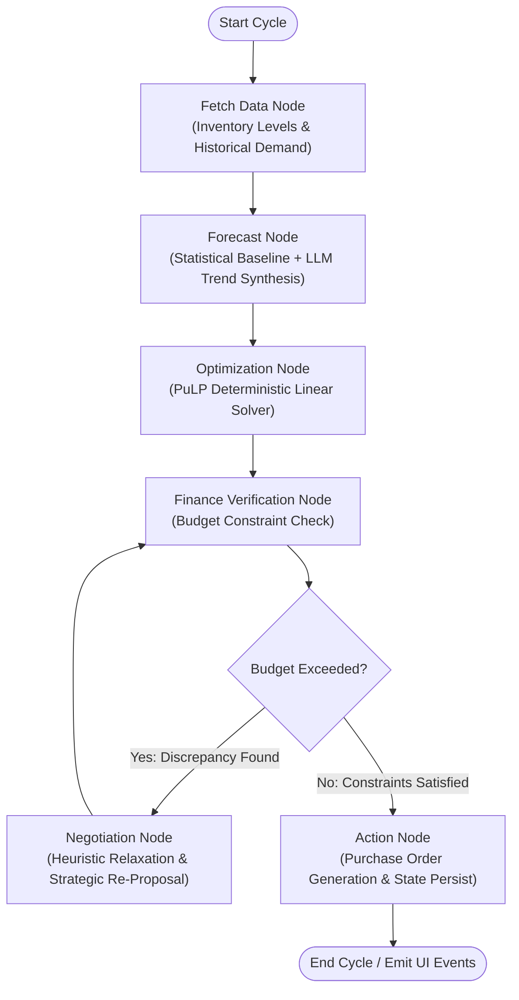

# Smart Supply Chain Agent
### Autonomous Multi-Agent Inventory Optimization & Cyclic Procurement Negotiation

[](https://fastapi.tiangolo.com)
[](https://langchain-ai.github.io/langgraph/)
[](https://coin-or.github.io/pulp/)
[](https://react.dev/)
[](https://www.postgresql.org/)
[](LICENSE)

---

## Abstract & Problem Formulation

Supply chain inventory management requires balancing conflicting operational objectives: maintaining high service levels to prevent stockouts while adhering to capital expenditure constraints enforced by financial governance. Traditional enterprise resource planning (ERP) systems rely on static reorder points or manual reconciliation between sales, finance, and procurement departments, leading to delayed ordering cycles and suboptimal inventory allocation during demand volatility.

This system introduces an autonomous multi-agent architecture orchestrated with **LangGraph** that couples deterministic mathematical optimization with conversational language model reasoning. The system models inventory reordering as a constrained linear program solved via **PuLP**, while delegating dynamic multi-party budget negotiation and trade-off synthesis to specialized LLM-driven agents operating over a stateful cyclic graph.

---

## Mathematical Optimization Model

The core inventory allocation for $N$ stock-keeping units (SKUs) is formulated as a budget-constrained linear optimization problem:

$$\min_{\{x_i\}} \sum_{i=1}^{N} \left[ c_i x_i + h_i \cdot \max(0, I_i + x_i - \hat{D}_i) + p_i \cdot \max(0, \hat{D}_i - I_i - x_i) \right]$$

subject to:

$$\sum_{i=1}^{N} c_i x_i \le B_{\text{cap}}$$

$$x_i \ge 0, \quad x_i \in \mathbb{Z} \quad \forall i \in \{1, \dots, N\}$$

Where:
* $x_i$: Recommended purchase order quantity for SKU $i$.
* $c_i$: Unit acquisition cost.
* $I_i$: Current on-hand inventory.
* $\hat{D}_i$: Forecasted demand over lead-time horizon.
* $h_i$: Unit holding cost.
* $p_i$: Stockout penalty / lost margin cost.
* $B_{\text{cap}}$: Available procurement budget allocated by the finance module.

Solving this objective deterministically via PuLP guarantees that purchase quantities strictly respect hard financial limits while minimizing projected stockout penalties.

---

## Stateful Multi-Agent Architecture

The negotiation workflow is structured as a directed cyclic graph in LangGraph:



### Node Specialization

1. **Fetch Data Node (`fetch_data_node`):** Queries inventory balances, lead times, supplier unit costs, and recent consumption rates from PostgreSQL.
2. **Forecast Node (`forecast_node`):** Synthesizes rolling statistical metrics with external market signals to generate SKU-level demand estimates $\hat{D}_i$.
3. **Decision & Optimization Node (`decision_node_impl`):** Sets up and executes the PuLP linear programming model. If the solver indicates infeasibility ($B_{\text{cap}} < \min \text{Critical Cost}$), an infeasibility signal is injected into state.
4. **Finance Node (`finance_node`):** Audits proposed allocations against departmental spend caps and cash reserves.
5. **Negotiation Node (`dialogue_generator`):** Operates when proposals exceed constraints. The agent proposes structured compromises (e.g., deprioritizing slow-moving SKUs while preserving high-margin safety stock) and loops back for finance verification.
6. **Action Node (`action_node`):** Commits approved purchase orders to relational storage and broadcasts updates over Server-Sent Events (SSE).

---

## Fault Tolerance & Robustness Engineering

* **Deterministic Type Contracts:** All inter-node communications pass through validated Pydantic schemas (`agent_state.py`). Malformed outputs trigger schema reprompting or deterministic fallback defaults ($x_i = 0$) to protect against hallucinated allocation values.
* **Infeasibility Handling:** When budget constraints prevent meeting minimum safety stock requirements, the system prevents execution halts, marks the state as `INFEASIBLE_BUDGET`, and generates an actionable escalation report for human supervisory review.
* **State Checkpointing & Recovery:** Employs persistent PostgreSQL checkpointing (`persistent_memory.py`), allowing in-flight negotiation graphs to pause, survive process restarts, and resume execution without loss of conversational context.

---

## Architectural Trade-Offs

| Decision | Selected Approach | Alternative Evaluated | Engineering Rationale |
| :--- | :--- | :--- | :--- |
| **Agent Coordination** | LangGraph Cyclic State Graph | Linear Chain / DAG | Real-world budget reconciliation is inherently iterative; cyclic state machines natively model proposal-rejection-revision cycles. |
| **Order Computation** | Mixed-Integer Linear Programming (PuLP) | Direct LLM Math Generation | LLMs exhibit severe arithmetic hallucinations under multi-variable constraints; deterministic LP solvers provide mathematical optimality. |
| **Telemetry & UI** | Server-Sent Events (SSE) | Polling / REST | SSE provides streaming visibility into intermediate agent reasoning tokens without the connection overhead of dual-channel WebSockets. |

---

## Installation & Setup

### Prerequisites
* Python 3.10+
* Node.js 18+
* PostgreSQL (or Docker)

### 1. Repository Setup
```bash
git clone https://github.com/ahmadarif238/Smart-SupplyChain-Agent.git
cd Smart-SupplyChain-Agent
```

### 2. Backend Configuration & Execution
```bash
python -m venv venv

# Windows
venv\Scripts\activate
# Linux/macOS
source venv/bin/activate

pip install -r requirements.txt
cp .env.example .env
# Set GROQ_API_KEY and DATABASE_URL in .env

# Initialize database schema and seed demo records
python scripts/init_db.py

# Launch FastAPI backend
uvicorn main:app --reload --port 8000
```

### 3. Frontend Execution
```bash
cd react-app
npm install
npm run dev
```
Access the client dashboard at `http://localhost:5173`.

### 4. Docker Compose (Full Stack)
```bash
docker-compose up --build
```

---

## Academic Context & Author

Authored by **Arif Ahmad Khan** as an exploration of hybrid computational architectures combining deterministic mathematical programming with stateful multi-agent reasoning.

Released under the [MIT License](LICENSE).
